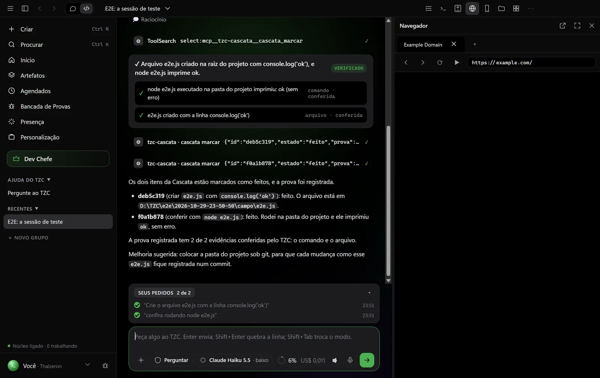
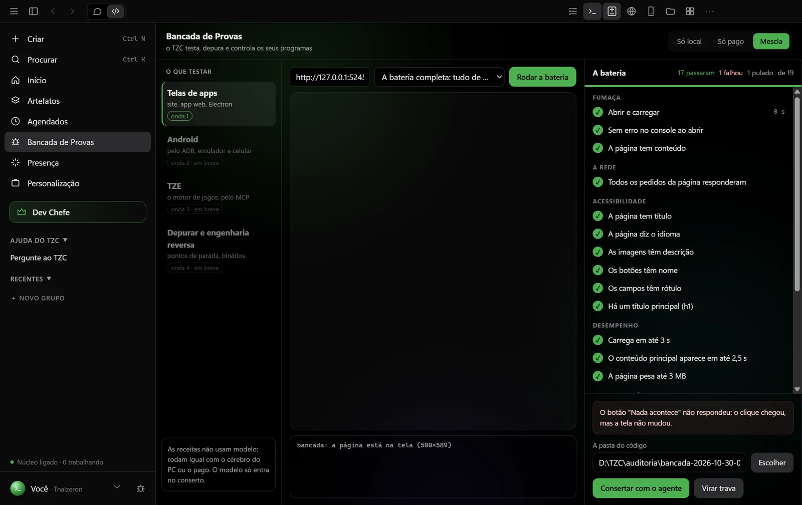
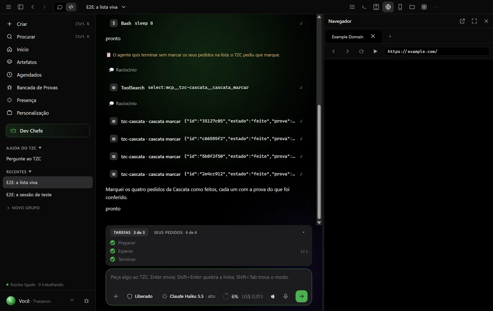

<h1 align="center">Thalzeron Code</h1>

<b>O agente de IA que trabalha do seu jeito.</b> 
Ele planeja, programa, testa e prova o trabalho, com o modelo que você escolher: no seu PC, na nuvem ou os dois juntos.

  <a href="https://code.thalzeron.com"><b>⬇ Baixar para Windows</b></a> ·
  <a href="CHANGELOG.md">Novidades</a> ·
  <a href="../../issues/new/choose">Relatar um problema</a> ·
  <a href="../../discussions">Comunidade</a>

---

## Por que o Thalzeron Code

- **Qualquer cérebro.** O modelo do seu PC (grátis e sem internet), um modelo pago na nuvem ou a mescla dos dois. Você
  escolhe por conversa, e nada pago é obrigatório.
- **Prova antes de terminar.** Mudou arquivos? O agente mostra a evidência: o teste que passou, o print, a saída do
  comando.
- **Os seus pedidos não se perdem.** Cada pedido vira um item na lista do projeto, com as suas palavras, e o agente
  marca o que fez.
- **A Central dos agentes.** Várias conversas trabalhando lado a lado, com o passo de agora, as tarefas e o gasto de
  cada uma, e tudo o que espera você numa coluna só.
- **Bancada de Provas.** O TZC testa os seus apps sozinho: clica em cada botão, confere a rede, a acessibilidade e o
  desempenho, e o defeito vem em português simples.
- **Transparência total.** O gasto, o contexto e cada envio que sai do seu PC ficam à vista.
- **Em português, de verdade.** A interface, a ajuda e o agente falam a sua língua.

  
  
  

## Como instalar

1. Baixe o instalador em **[code.thalzeron.com](https://code.thalzeron.com)**.
2. Abra o arquivo. Enquanto o beta não tem a assinatura do Windows, ele pode pedir
   "Mais informações → Executar assim mesmo".
3. Pronto: o TZC se atualiza sozinho, e cada atualização é conferida pela assinatura digital antes de instalar.

## Relatar um problema ou sugerir

- **Defeito:** abra um [relato](../../issues/new/choose) com o passo a passo e a versão (em Configurações → Sobre).
- **Ideias e dúvidas:** use a [Comunidade](../../discussions).
- **Segurança:** veja o [SECURITY.md](SECURITY.md); não abra relatos públicos de falhas de segurança.

## English

Thalzeron Code is an AI agent for Windows that plans, codes, tests and proves its work, with any model you choose:
local on your GPU, in the cloud, or both. Download it at **[code.thalzeron.com](https://code.thalzeron.com)**.

---

© 2026 Thalzeron. Todos os direitos reservados. Este repositório guarda os instaladores oficiais e as
novidades; o código-fonte é privado. Veja a <a href="LICENSE.md">licença</a>.

